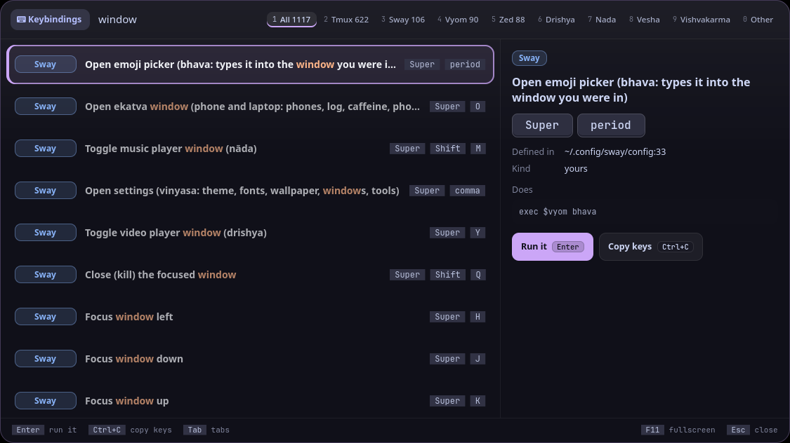

<p align="center">
  <picture>
    <source media="(prefers-color-scheme: dark)" srcset="assets/banner-dark.svg">
    <source media="(prefers-color-scheme: light)" srcset="assets/banner-light.svg">
    
  </picture>
</p>

<!-- identity -->
<p align="center">
  <b>यतो हस्तस्ततो दृष्टिर्यतो दृष्टिस्ततो मनः ।<br>
  यतो मनस्ततो भावो यतो भावस्ततो रसः ॥</b><br>
  <i>Where the hand goes the eyes follow; where the eyes go, the mind; where the mind goes, feeling; and where feeling goes, delight.</i><br>
  <sub>Abhinaya Darpaṇa, c. v. 37</sub>
</p>
<!-- /identity -->

<p align="center">
  <b>Search every keybinding (sway, tmux, kitty, zed, rmpc, tools...) by what it does; real key caps; Enter runs it.</b><br>
  Keybinding search. A tool for <a href="https://github.com/Theyashsawarkar/vyom">Vyom</a>, keyboard-driven panels for Wayland.
</p>

<p align="center">
  <a href="https://github.com/Theyashsawarkar/mudra/actions/workflows/ci.yml"></a>
  <a href="https://github.com/Theyashsawarkar/mudra/releases"></a>
  <a href="LICENSE"></a>
  <a href="https://github.com/Theyashsawarkar/vyom"></a>
  
  
</p>

<p align="center">
  
</p>

> *Mudra* (मुद्रा) is Sanskrit for "gesture": a gesture with a meaning, which is what a key binding is.

mudra is keybinding search for [Vyom](https://github.com/Theyashsawarkar/vyom): one keyboard-driven panel that opens instantly, with live data, a preview and a key for everything. It runs on any compositor with the layer-shell protocol (sway, Hyprland, river, niri, Wayfire, labwc…). In [Vayu](https://github.com/Theyashsawarkar/vayu), the desktop it was built for, it replaces keybind-search.py's wofi popup.

## Contents

- [Features](#features)
- [Install](#install)
- [Usage](#usage)
- [Configuration](#configuration)
- [Troubleshooting](#troubleshooting)
- [The Vyom family](#the-vyom-family)
- [Contributing](#contributing)
- [License](#license)

## Features

- Every keybinding **by what it does** ("kill window", "volume"), the words you typed in peach, with real **key caps** at the right and chords joined by a quiet "then" (`Ctrl A then &`), in your theme's colours.
- **Each app is a coloured chip** at the start of its rows (Sway, Tmux, Zed, Vyom…), always the same colour.
- **Clashes stand out**: a key bound twice in the same app and scope gets a red "Clash" chip, and the preview says what else it does.
- **Or by its keys**: type `ctrl+h`, `super q`, `alt 1`, `prefix s` and you get what those keys do, exact matches first.
- **Vim and leader keys read as they're typed**: a bare letter keeps its case (`g › g` is not `G`), a Space-leader sequence is caps joined by a quiet › (`Space › y › y`) with the Space cap in your accent, and each row has a neutral **mode** chip (normal, insert) and a **leader** chip.
- **Which-key search**: `space y` (or `spc y`, `<leader>y`) lists everything under `Space y`, in order, shortest first; the preview shows the path with the group names ("Space › y Copy › y the answer").
- A **Leader tab**: every tool's Space tree side by side. A key that uses a shared leader group for something else (Space m is mark in every tool, Space s sort…) gets a red Clash chip, as does a key bound twice in one mode or one that starts a longer one (`g` beside `g g`).
- **Every word counts, in any order**: "tmux kill", "window kill", "wifi" (finds Wi-Fi).
- While you search, one list ranked by match; with an empty box, grouped by app with a count on each group.
- **Vyom is one app with a section per tool** (`Vyom · ganit`, `Vyom · tarang`…), every panel's own keys first. A tool's name or title finds its keys: "ganit", "calculator", "tarang enter".
- A **tab per app**, most bindings first (its count in the tooltip); the smallest apps share an "Other" tab. `Ctrl+2` is the second, `Tab` the next.
- The preview shows the keys as big caps, **where it's defined** (`~/.config/sway/config:142` for sway, kitty and zed; the file for a tool's own keys) and what it does, with **Run it** (`Enter`) and **Copy keys** (`y y`) buttons; `o` opens that file in $EDITOR at the line.
- `Enter` **runs the binding**: sway ones through swaymsg, tmux ones replayed into your most recent tmux client; anything else copies its keys.
- Bindings come from a command printing JSON (Vayu's `keybind-search.py --json`); without one it reads sway's own config.
- Keyboard first: every action has a key, shown in the footer; the mouse works too.
- Never freezes the panel: slow commands run in the background.

## Install

### Requirements

- [Vyom](https://github.com/Theyashsawarkar/vyom) 0.6 or newer (Python 3.11+, PyGObject, GTK 4, [gtk4-layer-shell](https://github.com/wmww/gtk4-layer-shell), a Nerd Font)
- optional: swaymsg, tmux (running bindings)

### Install

```sh
git clone https://github.com/Theyashsawarkar/mudra ~/.local/share/vyom/plugins/mudra
vyom reload           # pick it up (or log out and in)
vyom mudra            # open it; run it again to close
```

Give it a key in your compositor, e.g. sway:

```sh
bindsym $mod+<key> exec vyom mudra
```

### Update and uninstall

```sh
git -C ~/.local/share/vyom/plugins/mudra pull && vyom reload     # update
rm -rf ~/.local/share/vyom/plugins/mudra && vyom reload          # uninstall
```

## Usage

Open it with `vyom mudra` (or your key). It opens in insert mode: type to search. `Esc` goes to normal mode, where every key is a command and `Space` is the leader (a strip shows what comes next); `i` or `/` types again. The footer always shows the keys for what's selected.

<!-- KEYS (generated by scripts/keybinds.py from mudra/vim.py) -->

Vyom's keys work too (every vim tool has them): `?` and `Space ?` list every key, `Space Space` is the palette, `j` / `k` move, `gg` / `G` jump, `/` searches again, `H` / `L` switch tabs, `q` closes, `Space u f` is fullscreen, `Esc` steps back.

**Insert mode (typing; mudra opens in it)**

| Key | Action |
|---|---|
| `Enter` | Run the selected keybinding (sway and tmux), else copy its keys |

**Normal mode**

| Key | Action |
|---|---|
| `Enter` | Run the selected keybinding (sway and tmux), else copy its keys |
| `y y` | Copy the selected keybinding's keys |
| `o` | Open the file that defines it in $EDITOR (at its line when known) |

**Leader (Space)**

| Key | Action |
|---|---|
| `Space t a / Space t 1..9` | Switch to All / that app's tab |
| `Space f c` | Show only clashes (or everything again) |
| `Space f m` | Show only one mode's keys: normal, then insert, then every mode |
| `Space f d` | Hide built-in keys (or show them again) |
| `Space f k` | Search by keys only: dd, gg, x (or by words again) |
| `Space f l` | Show every Space-leader key of every tool (the Leader tab) |
| `Space f f` | Search again (clear the box and type) |
| `Space y y` | Copy the selected keybinding's keys |
| `Space y d` | Copy the selected keybinding's description |
| `Space y c` | Copy the selected keybinding's command |
| `Space o e` | Open the file that defines it in $EDITOR |
| `Space r` | Read every keybinding again |

<!-- END KEYS -->


## Configuration

Everything is optional, in `~/.config/vyom/config.toml` under `[plugin.mudra]`:

| Setting | Default | What it does |
|---|---|---|
| `source_command` | keybind-search.py --json (if installed) | Command printing the bindings as JSON |

Run `vyom reload` after editing.

## Troubleshooting

- **Nothing opens.** `vyom list` shows every installed tool, and why one is skipped (a missing requirement, or a Vyom that's too old).
- **It opened, then something failed.** Look for a `Traceback` in the daemon's log, `journalctl --user -u vyom -u vyom-daemon -b` (without systemd: `~/.local/state/vyom/daemon.log`), and [open an issue](https://github.com/Theyashsawarkar/mudra/issues/new/choose) with it.
- **No blur or rounded corners.** That's the compositor: on SwayFX, add `layer_effects "vyom" { blur enable; corner_radius 20; shadows enable }`.

## The Vyom family

Each tool is its own repository, so you install only the ones you want:

| Tool | | What it does |
|---|---|---|
| [dvara](https://github.com/Theyashsawarkar/dvara) | द्वार, gateway | The app launcher |
| [ganit](https://github.com/Theyashsawarkar/ganit) | गणित, mathematics | The calculator and converter |
| [smriti](https://github.com/Theyashsawarkar/smriti) | स्मृति, memory | Clipboard history |
| [bhava](https://github.com/Theyashsawarkar/bhava) | भाव, feeling, emotion | The emoji picker |
| [tarang](https://github.com/Theyashsawarkar/tarang) | तरंग, wave | Wi‑Fi and the hotspot |
| [setu](https://github.com/Theyashsawarkar/setu) | सेतु, bridge | Bluetooth |
| [doot](https://github.com/Theyashsawarkar/doot) | दूत, messenger | Your phone, through KDE Connect |
| [patra](https://github.com/Theyashsawarkar/patra) | पात्र, vessel | Docker containers |
| [akashvani](https://github.com/Theyashsawarkar/akashvani) | आकाशवाणी, voice from the sky | Notifications |
| [raga](https://github.com/Theyashsawarkar/raga) | राग, melody | YouTube music and video |
| [mudra](https://github.com/Theyashsawarkar/mudra) (this one) | मुद्रा, gesture | Keybinding search |
| [urja](https://github.com/Theyashsawarkar/urja) | ऊर्जा, energy | The battery at a glance |
| [vishram](https://github.com/Theyashsawarkar/vishram) | विश्राम, rest | The power menu |
| [kendra](https://github.com/Theyashsawarkar/kendra) | केन्द्र, centre | Quick settings |

## Contributing

Bug reports, ideas and pull requests are welcome: see [CONTRIBUTING.md](CONTRIBUTING.md) for the development setup and the few rules every tool follows, and [CHANGELOG.md](CHANGELOG.md) for what changed in each release. Please report security issues privately ([SECURITY.md](SECURITY.md)).

## License

[MIT](LICENSE).
